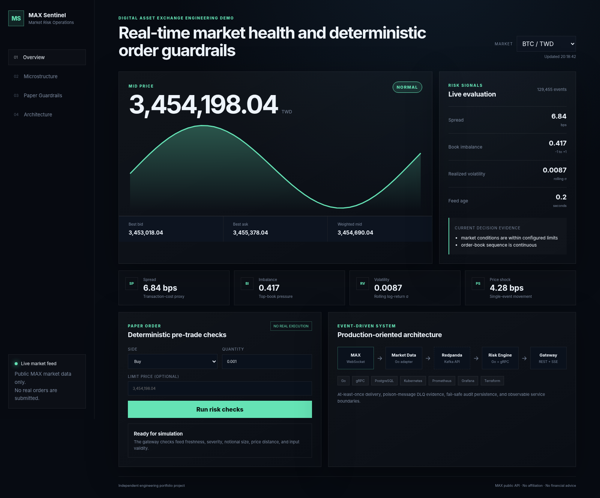
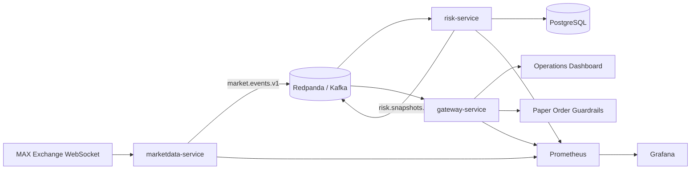

# MAX Sentinel

[](https://github.com/rufushsu9987/max-sentinel/actions/workflows/ci.yml)
[](https://github.com/rufushsu9987/max-sentinel/actions/workflows/codeql.yml)
[](LICENSE)

**Real-time market data, risk monitoring, and paper-order guardrails built for the MAX Exchange public API.**

MAX Sentinel is a portfolio project designed around the engineering concerns of a production digital-asset exchange: streaming market data, low-latency processing, deterministic risk rules, service observability, relational persistence, and Kubernetes deployment.

> This project is an independent technical demonstration. It is not affiliated with MaiCoin or MAX, and it never places real orders.



_Dashboard preview rendered with deterministic demo data._

## Why this project exists

MaiCoin's current software-engineering openings emphasize Go, microservices, gRPC, relational databases, Kubernetes, high scalability, low latency, exchange API integration, and Prometheus/Grafana. MAX Sentinel turns those requirements into one coherent, interview-ready system.

## What it demonstrates

- **Go microservices** with explicit bounded contexts
- **MAX WebSocket ingestion** for book, trade, and ticker channels
- **Kafka-compatible event streaming** through Redpanda, with retry and dead-letter handling
- **Deterministic risk engine** for spread, imbalance, volatility, feed freshness, and price shock
- **gRPC risk evaluation API** using Protocol Buffers
- **PostgreSQL persistence** for auditability and replay
- **SSE dashboard feed** for browser-friendly real-time updates
- **Paper-order guardrails** that reject risky, stale, or oversized orders
- **Prometheus + Grafana observability**
- **Docker Compose, Kubernetes, and Terraform** deployment assets
- **Backtest CLI** for strategy and simulation-fidelity discussion

## Architecture



## Quick start

### Full local stack

```bash
cp .env.example .env
go mod tidy
docker compose -f deploy/docker-compose.yml up --build
```

Open:

- Dashboard: `http://localhost:8080`
- Gateway metrics: `http://localhost:8080/metrics`
- Market-data metrics: `http://localhost:8081/metrics`
- Risk metrics: `http://localhost:8082/metrics`
- Prometheus: `http://localhost:9091`
- Grafana: `http://localhost:3000` (`admin` / `admin`)

### Deterministic demo mode

Demo mode does not require MAX, Kafka, or PostgreSQL. It generates realistic snapshots so the UI and paper-order flow can be reviewed immediately.

```bash
make demo
```

### Replay normalized fixtures

To review deterministic event handling without mixing in the live upstream feed:

```bash
docker compose -f deploy/docker-compose.yml stop marketdata
make replay
```

## Key APIs

```text
GET  /healthz
GET  /readyz
GET  /api/v1/markets
GET  /api/v1/markets/{market}/snapshot
GET  /api/v1/stream?market=btctwd
POST /api/v1/paper/orders
GET  /metrics
```

Example paper order:

```bash
curl -X POST http://localhost:8080/api/v1/paper/orders \
  -H 'content-type: application/json' \
  -d '{
    "market":"btctwd",
    "side":"buy",
    "quantity":"0.001",
    "limit_price":"3500000"
  }'
```

## Repository layout

```text
cmd/
  marketdata/   MAX WebSocket ingestion
  risk/         Kafka consumer, risk calculation, gRPC API
  gateway/      REST, SSE, dashboard, paper-order guardrails
  backtest/     Small backtesting CLI
internal/
  maxws/        MAX protocol adapter and normalization
  orderbook/    Deterministic L2 book implementation
  risk/         Pure risk calculations and thresholds
  bus/          Kafka adapters
  store/        PostgreSQL persistence
  grpcapi/      gRPC service implementation
proto/          Risk service contract
deploy/         Compose, Prometheus, Grafana, Kubernetes
infra/          Terraform reference deployment
migrations/     PostgreSQL schema
docs/           Architecture, interview story, security, roadmap
```

## Engineering decisions

1. **Public market data only.** No API secret is needed for the core demo.
2. **Raw-event preservation.** Normalized events keep the original payload for debugging and replay.
3. **Risk rules stay deterministic.** AI may explain incidents later, but it cannot approve orders.
4. **At-least-once event delivery.** Consumers retry transient failures, use bounded in-process event-ID deduplication, preserve audit records with database uniqueness, and route malformed poison records to a dead-letter topic.
5. **Environment-aware failure policy.** Demo mode degrades gracefully; production can require PostgreSQL so an audit-write failure prevents Kafka offset commit.
6. **No fake performance claims.** The repository includes deterministic replay fixtures and a performance-test plan; results should be measured on the target environment before being added to a resume.

## Testing and validation

```bash
make bootstrap
make test-pure
make test
make validate
```

The project declares Go 1.25 as its minimum; CI and container builds use the Go 1.26 release line.

The pure domain tests cover order-book updates, spread, imbalance, volatility, stale-feed detection, and severity classification.

## Resume-ready summary

See [`docs/APPLICATION_GUIDE_ZH-TW.md`](docs/APPLICATION_GUIDE_ZH-TW.md), [`docs/RESUME_BULLETS.md`](docs/RESUME_BULLETS.md), [`docs/INTERVIEW_GUIDE.md`](docs/INTERVIEW_GUIDE.md), and [`docs/VALIDATION.md`](docs/VALIDATION.md).

## Suggested next milestones

- Add authenticated MAX private API integration behind a feature flag and a least-privilege subaccount
- Add consumer-lag and end-to-end latency SLO dashboards
- Add replay-based load testing and p95/p99 latency reports
- Add rebalance-safe state restoration, then shard risk workers by Kafka partition
- Add Kubernetes canary rollout and chaos testing
- Add a governed LLM incident explainer using retrieved runbooks and immutable evidence
