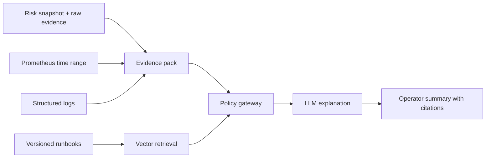

# Governed AI Extension: Incident Explainer

This is an optional second milestone that connects the project to an AI/LLM background without weakening financial controls.

## User story

An operator selects a `WARNING` or `CRITICAL` snapshot and asks:

- What changed?
- Which deterministic thresholds fired?
- Has this failure happened before?
- Which runbook steps apply?

## Architecture

## Guardrails

- The model receives immutable snapshot IDs and time-bounded evidence.
- Every statement links to metrics, logs, events, or a versioned runbook chunk.
- The model cannot call an order API.
- Deterministic risk severity remains authoritative.
- Prompt, model, retrieved evidence IDs, and output are audited.
- PII and secrets are redacted before model invocation.
- A low-confidence response must say evidence is insufficient.

## Evaluation

Create a fixture set of incidents and score:

- citation correctness
- root-cause classification accuracy
- unsupported-claim rate
- action safety
- response latency and token cost

This extension is useful for an AI-focused interview, but the core exchange project should remain fully usable without it.
