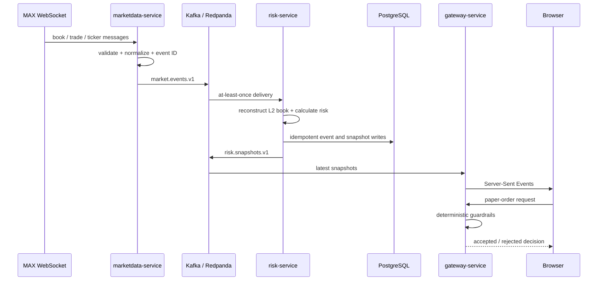

# Architecture and Engineering Notes

## 1. System goal

MAX Sentinel demonstrates how to ingest public exchange data, normalize it into stable contracts, calculate deterministic risk signals, persist immutable evidence, and expose an operations-oriented dashboard without ever placing a real order.

The architecture deliberately separates ingestion, risk calculation, and presentation so each service can scale and fail independently.

## 2. Runtime flow

## 3. Bounded contexts

| Service | Responsibility | State | Scaling signal |
|---|---|---|---|
| `marketdata` | MAX WebSocket connection, protocol normalization, event publication | Connection-local | one active worker per market assignment; scale by explicit market sharding or leader election |
| `risk` | Order-book reconstruction, volatility and severity calculation, persistence, gRPC query | Local market state | reference deployment uses one active worker; scale only after adding partition-state restore/changelog |
| `gateway` | REST/SSE, latest snapshot cache, paper-order policy | Ephemeral latest state | horizontal replicas; each uses an instance-scoped consumer group to receive the full snapshot stream |

## 4. Event contracts

### `market.events.v1`

Key fields:

- `event_id`: deterministic identity used for idempotency
- `source`: data origin (`max`)
- `type`: `book.snapshot`, `book.update`, `trade.update`, or `ticker.update`
- `market`: lower-case market identifier
- `occurred_at` and `received_at`: exchange time versus ingest time
- `raw`: original payload for audit and parser debugging

### `risk.snapshots.v1`

Contains the latest best bid/ask, midpoint, spread, imbalance, weighted midpoint, rolling realized volatility, event price shock, feed age, severity, and human-readable deterministic reasons.

Schema evolution rules:

1. Add optional fields rather than changing existing meaning.
2. Never reuse an event type with incompatible semantics.
3. Keep consumers tolerant of unknown fields.
4. Version the topic for a breaking contract change.

## 5. Consistency and delivery semantics

The event bus is treated as **at least once**. Duplicate delivery is expected. PostgreSQL uses unique event IDs to keep the audit log idempotent, while the process keeps a bounded in-memory event-ID cache to avoid duplicate calculations during normal retries. A consumer commits only after processing and publication succeed. Transient failures retry the same record; non-retryable poison records are wrapped with source metadata and raw base64 payload, published to `<source-topic>.dlq`, and committed only after the dead-letter write succeeds.

For strict per-market ordering, use `market` as the Kafka message key. That routes all events for one market to the same partition. The reference risk deployment intentionally stays single-replica because its order book is local memory; production horizontal scaling requires restoring partition state from a compacted changelog, durable state store, or a fresh snapshot before processing deltas after reassignment.

## 6. Risk calculations

The current engine is intentionally deterministic:

- bid–ask spread in basis points
- depth-based order-book imbalance
- weighted midpoint
- rolling log-return volatility
- single-event price shock
- stale-feed detection

The sample implementation uses `float64` to keep the demo readable. Production money and quantity calculations should use fixed-point decimal or scaled integers to avoid binary floating-point errors.

## 7. Latency budget and SLO targets

These are **design targets, not measured claims**:

| Stage | Target |
|---|---:|
| WebSocket receive → normalized event | p99 < 10 ms |
| Kafka publish | p99 < 20 ms |
| Risk processing | p99 < 15 ms |
| Snapshot publish → gateway cache | p99 < 30 ms |
| REST snapshot API | p99 < 100 ms |
| Freshness | 99.9% of snapshots < 10 seconds old |

Measure them with timestamps carried through the event envelope, Prometheus histograms, and trace IDs. Do not place these numbers on a résumé until a reproducible load test exists.

## 8. Failure handling

| Failure | Behavior | Recovery |
|---|---|---|
| MAX disconnect | Exponential backoff with jitter | reconnect and request a fresh book snapshot |
| malformed MAX WebSocket payload | drop with metric and structured log | inspect preserved raw samples and update adapter |
| malformed Kafka payload | publish evidence envelope to source DLQ | alert, inspect, fix producer/consumer contract, and replay |
| Kafka unavailable | publisher returns error; service restarts | reconnect through orchestrator; replay upstream |
| PostgreSQL unavailable | production-required mode stops startup or retries the same Kafka offset; optional demo mode may continue | restore database, then resume/replay from Kafka |
| stale feed | severity becomes `CRITICAL` | block paper orders until feed recovers |
| slow browser | bounded SSE queue drops stale intermediate state | client receives latest subsequent snapshot |

## 9. Production improvements

- use schema registry with Protobuf or Avro
- add bounded retries, DLQ retention policy, alerting, and a controlled replay tool
- add a compacted state changelog and rebalance-safe order-book restoration before scaling risk workers
- separate raw and normalized topics
- expose sequence-gap/reconnect counters and alert thresholds
- add OpenTelemetry traces and exemplars
- use IAM authentication for MSK and RDS where supported
- use External Secrets or Secrets Store CSI rather than plaintext Kubernetes Secrets
- use KEDA based on Kafka consumer lag
- add canary deployment, chaos tests, and regional failover exercises
